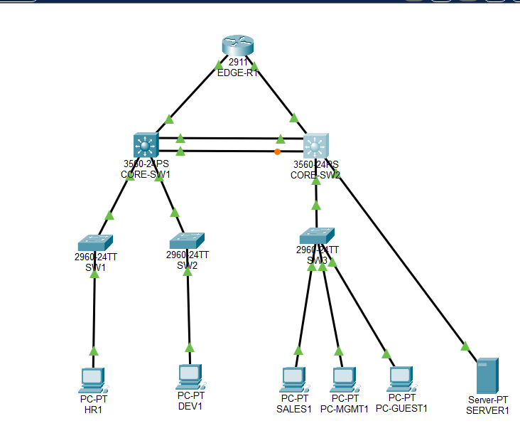

# Cisco 기반 Enterprise Network 설계·구축 및 장애 대응

Cisco Packet Tracer를 활용하여 기업 네트워크 환경을 설계하고 구축하는 프로젝트입니다.

VLAN 기반 네트워크 분리, Inter-VLAN Routing, HSRP 이중화, EtherChannel, STP, ACL 접근 제어 등을 구현하고, 실제 통신 테스트와 장애 분석을 통해 네트워크 구성의 정상 동작을 검증합니다.

단순한 명령어 실습을 넘어 **네트워크 설계 → 구축 → 검증 → 장애 분석 및 대응 → 문서화** 과정을 직접 경험하는 것을 목표로 합니다.

---

## 1. Project Overview

### 프로젝트 목적

- 기업 환경을 가정한 네트워크 토폴로지 설계
- Cisco Switch 및 Router 기반 네트워크 구축
- VLAN을 이용한 부서별 네트워크 분리
- Inter-VLAN Routing을 통한 VLAN 간 통신 구현
- HSRP를 이용한 기본 게이트웨이 이중화
- EtherChannel을 이용한 링크 통합
- STP를 통한 네트워크 루프 방지
- ACL을 이용한 네트워크 접근 제어
- Ping 및 Cisco show 명령어를 활용한 네트워크 검증
- 장애 발생 시 원인 분석 및 복구 과정 문서화

### Project Environment

| 구분 | 사용 기술 |
|---|---|
| Network Simulator | Cisco Packet Tracer |
| Vendor | Cisco |
| Switching | VLAN, Access Port, Trunk |
| Routing | Inter-VLAN Routing |
| Redundancy | HSRP |
| Link Aggregation | EtherChannel |
| Loop Prevention | STP |
| Network Security | Standard ACL, Extended ACL |
| Verification | Ping, show commands |
| Documentation | GitHub |

---

## 2. Network Architecture

본 프로젝트는 기업 내부에 여러 부서와 서버, 네트워크 관리 및 외부 방문자용 네트워크가 존재하는 환경을 가정합니다.

## Network Topology

기업 네트워크 환경을 가정하여 CORE-SW1과 CORE-SW2를 중심으로
VLAN 기반 네트워크 및 이중화 구조를 설계했습니다.



### Network Design

- CORE-SW1 / CORE-SW2를 중심으로 이중화된 코어 네트워크 구성
- VLAN을 활용하여 부서별 네트워크 분리
- HSRP를 통해 가상 기본 게이트웨이 제공
- EtherChannel을 통해 스위치 간 링크 통합
- STP를 통해 이중 연결 구조에서 발생할 수 있는 루프 방지
- GUEST VLAN에 Extended ACL을 적용하여 내부 네트워크 접근 제한

### VLAN & IP Addressing Plan

| VLAN | 이름 | 네트워크 | 용도 |
|---|---|---|---|
| 10 | HR | 10.10.10.0/24 | 인사팀 |
| 20 | DEV | 10.10.20.0/24 | 개발팀 |
| 30 | SALES | 10.10.30.0/24 | 영업팀 |
| 40 | SERVER | 10.10.40.0/24 | 서버 |
| 50 | MGMT | 10.10.50.0/24 | 네트워크 관리 |
| 60 | GUEST | 10.10.60.0/24 | 방문자 네트워크 |

### HSRP Gateway Design

각 VLAN에 HSRP 가상 게이트웨이를 구성했습니다.

| VLAN | Virtual IP | CORE-SW1 | CORE-SW2 |
|---|---|---|---|
| 10 | 10.10.10.1 | 10.10.10.254 | 10.10.10.253 |
| 20 | 10.10.20.1 | 10.10.20.254 | 10.10.20.253 |
| 30 | 10.10.30.1 | 10.10.30.254 | 10.10.30.253 |
| 40 | 10.10.40.1 | 10.10.40.254 | 10.10.40.253 |
| 50 | 10.10.50.1 | 10.10.50.254 | 10.10.50.253 |
| 60 | 10.10.60.1 | 10.10.60.254 | 10.10.60.253 |

- CORE-SW1: Priority 110, Active
- CORE-SW2: Priority 100, Standby
- 두 코어 스위치에 Preempt 설정 적용

---

## 3. Implementation

### 3-1. VLAN & Inter-VLAN Routing

부서별 네트워크를 VLAN으로 분리하고 각 VLAN에 SVI를 구성하여 VLAN 간 통신을 구현했습니다.

구현 내용:
- VLAN 10~60 생성
- 부서별 Access Port 할당
- 스위치 간 Trunk 구성
- SVI 기반 Inter-VLAN Routing
- VLAN별 IP 대역 및 기본 게이트웨이 구성

### 3-2. HSRP

코어 스위치 두 대에 HSRP를 구성하여 게이트웨이 이중화 환경을 구축했습니다.

구현 내용:
- VLAN별 HSRP 그룹 구성
- Virtual IP 설정
- Priority 조정을 통한 Active / Standby 지정
- Preempt 설정
- `show standby brief`를 이용한 상태 확인

### 3-3. EtherChannel

스위치 간 물리 링크를 논리적인 하나의 링크로 통합했습니다.

구현 내용:
- PAgP 기반 EtherChannel 구성
- Port-Channel 1 생성
- Trunk 연결 구성
- EtherChannel 상태 확인

검증 명령어:

```cisco
show etherchannel summary
show interfaces trunk
```

확인 결과:

```text
Po1(SU)   PAgP   Fa0/1(P)
```

- S: Layer 2 Port-Channel
- U: 정상적으로 사용 중
- P: 물리 인터페이스가 Port-Channel에 번들링됨

### 3-4. STP

이중화된 스위치 연결 환경에서 네트워크 루프를 방지하기 위해 STP 동작을 확인했습니다.

구현 및 확인 내용:
- Root Bridge 확인
- Designated / Root / Alternate Port 확인
- Forwarding / Blocking 상태 확인
- EtherChannel과 STP의 연동 상태 확인

검증 명령어:

```cisco
show spanning-tree vlan 60
```

CORE-SW2의 Port-Channel이 Alternate / Blocking 상태로 확인되었으며, 이는 중복 경로로 인한 루프를 방지하기 위한 STP 동작입니다.

---

## 4. Network Security - ACL

### GUEST Network Isolation

방문자용 GUEST VLAN에서 기업 내부 네트워크로 임의 접근하는 것을 제한하기 위해 Extended ACL을 구성했습니다.

정책 목표:
- GUEST VLAN에서 내부 부서 네트워크로 시작하는 통신 차단
- 내부 네트워크에서 GUEST로 시작한 ICMP Ping의 응답 허용
- 그 외 정책에 해당하지 않는 트래픽은 ACL의 마지막 Permit 규칙으로 처리

### GUEST-IN ACL

적용 인터페이스:
- CORE-SW1: VLAN 60 SVI, Inbound
- CORE-SW2: VLAN 60 SVI, Inbound

주요 ACL 규칙:

```cisco
ip access-list extended GUEST-IN
 5 permit icmp 10.10.60.0 0.0.0.255 10.10.10.0 0.0.0.255 echo-reply
 6 permit icmp 10.10.60.0 0.0.0.255 10.10.20.0 0.0.0.255 echo-reply
 7 permit icmp 10.10.60.0 0.0.0.255 10.10.30.0 0.0.0.255 echo-reply
 8 permit icmp 10.10.60.0 0.0.0.255 10.10.40.0 0.0.0.255 echo-reply
 9 permit icmp 10.10.60.0 0.0.0.255 10.10.50.0 0.0.0.255 echo-reply
 10 deny ip 10.10.60.0 0.0.0.255 10.10.10.0 0.0.0.255
 20 deny ip 10.10.60.0 0.0.0.255 10.10.20.0 0.0.0.255
 30 deny ip 10.10.60.0 0.0.0.255 10.10.30.0 0.0.0.255
 40 deny ip 10.10.60.0 0.0.0.255 10.10.40.0 0.0.0.255
 50 deny ip 10.10.60.0 0.0.0.255 10.10.50.0 0.0.0.255
 60 permit ip any any
```

### ACL 정책 설계 시 고려사항

ICMP Echo Reply 예외 규칙을 Deny 규칙보다 먼저 배치했습니다.

이를 통해 내부 네트워크에서 시작한 Ping에 대해 GUEST PC가 응답할 수 있도록 구성했습니다.

단, 이 ACL은 상태 기반 방화벽이 아닙니다. ICMP Echo Reply만 예외적으로 허용하는 방식이며, TCP/UDP 세션의 반환 트래픽까지 자동으로 허용하는 구성은 아닙니다.

---

## 5. Verification & Test Results

구성한 네트워크가 의도한 정책대로 동작하는지 PC 간 Ping 테스트와 ACL Match Count를 통해 확인했습니다.

### 5-1. Inter-VLAN Communication

확인 내용:
- HR VLAN에서 DEV VLAN 통신
- HR VLAN에서 SALES VLAN 통신
- HR VLAN에서 SERVER VLAN 통신

기존 테스트에서 정상 응답을 확인했습니다.

### 5-2. GUEST Network Access Control

| 테스트 | 결과 | 비고 |
|---|---|---|
| GUEST → Gateway | 성공 | 10.10.60.1 응답 확인 |
| HR → GUEST | 성공 | 4/4 응답 |
| GUEST → HR | 차단 | Destination host unreachable |
| GUEST → DEV | 차단 기록 확인 | ACL Deny Match |
| GUEST → SALES | 차단 기록 확인 | ACL Deny Match |
| GUEST → SERVER | 차단 기록 확인 | ACL Deny Match |
| GUEST → MGMT | 차단 기록 확인 | ACL Deny Match |

### 5-3. ACL Match Count

`show ip access-lists` 명령어를 이용해 ACL 규칙별 패킷 매칭 횟수를 확인했습니다.

확인된 주요 항목:
- ICMP Echo Reply 허용 규칙에서 Match Count 발생
- HR, DEV, SALES, SERVER, MGMT 차단 규칙에서 Match Count 발생
- 마지막 Permit 규칙에서도 Match Count 발생

이를 통해 ACL이 실제 트래픽에 적용되고 규칙별로 매칭되는 것을 확인했습니다.

검증 명령어:

```cisco
show ip access-lists
show standby brief
show interfaces trunk
show etherchannel summary
show spanning-tree vlan 60
show vlan brief
```

---

## 6. Troubleshooting

프로젝트 진행 과정에서 발생한 통신 문제를 Cisco 명령어와 실제 패킷 테스트를 통해 분석했습니다.

### Scenario 1. GUEST VLAN 접근 제어 문제

**Problem**

GUEST VLAN에서 내부 VLAN으로의 통신을 제한하면서 내부 VLAN에서 GUEST VLAN으로 시작한 Ping은 허용해야 하는 요구사항이 있었습니다.

**Investigation**

- VLAN 60 SVI 상태 확인
- HSRP 상태 확인
- Trunk 및 STP 상태 확인
- GUEST-IN ACL 규칙 순서 확인
- PC 간 Ping 테스트
- ACL Match Count 확인

**Resolution**

GUEST-IN ACL에 ICMP Echo Reply 예외 규칙을 추가하고, 기존 내부망 차단 규칙보다 먼저 처리되도록 구성했습니다.

**Verification**

- HR → GUEST: Ping 성공
- GUEST → HR: Ping 차단
- ACL Match Count 증가 확인

**Result**

의도한 ICMP 접근 제어 정책이 동작하는 것을 확인했습니다.

---

## 7. Project Status

현재 구현 및 검증된 항목과 향후 확장 항목을 구분합니다.

### Completed

- [x] Enterprise Network 기본 설계
- [x] Cisco Packet Tracer 환경 구축
- [x] VLAN 10~60 구성
- [x] Access Port 및 Trunk 구성
- [x] Inter-VLAN Routing
- [x] HSRP Active / Standby 구성
- [x] EtherChannel 구성
- [x] STP 동작 확인
- [x] GUEST-IN Extended ACL 구성
- [x] 내부망 및 GUEST 간 ICMP 접근 제어 테스트
- [x] ACL Match Count 확인
- [x] 스위치 설정 저장

### Planned

- [ ] HSRP Failover 장애 테스트
- [ ] EtherChannel 링크 장애 테스트
- [ ] Trunk 및 VLAN 장애 재현
- [ ] SSH 관리 접근 제어 검증
- [ ] OSPF 동적 라우팅 구성 및 검증
- [ ] NAT/PAT 및 외부 네트워크 연결
- [ ] Python 기반 네트워크 점검 자동화
- [ ] 설정 백업 자동화
- [ ] 최종 네트워크 토폴로지 및 테스트 증적 정리

---

## 8. Repository Structure

```text
Cisco-Enterprise-Network/
│
├── README.md
│
├── 01_Network_Design/
│   ├── topology/
│   ├── ip_plan/
│   └── vlan_plan/
│
├── 02_Switching/
│   ├── vlan/
│   ├── trunk/
│   ├── stp/
│   └── etherchannel/
│
├── 03_Routing/
│   └── inter_vlan/
│
├── 04_High_Availability/
│   └── hsrp/
│
├── 05_Security/
│   ├── acl/
│   └── ssh/
│
├── 06_Troubleshooting/
│   ├── vlan_issue/
│   ├── acl_issue/
│   ├── stp_issue/
│   └── etherchannel_issue/
│
└── packet_tracer/
    └── enterprise_network.pkt
```

※ 위 디렉터리 구조는 프로젝트 진행에 따라 추가할 예정입니다.

---

## 9. Final Objective

최종 목표는 기업 네트워크 환경을 직접 설계하고 구축한 뒤, 네트워크 이중화와 보안 정책을 적용하고 장애 상황에 대응할 수 있는 역량을 확보하는 것입니다.

**Design → Implementation → Verification → Troubleshooting → Improvement → Documentation**

이 프로젝트를 통해 Cisco 기반 Routing / Switching 기술뿐 아니라 네트워크 운영, 접근 제어, 장애 원인 분석 및 대응 능력을 함께 발전시키는 것을 목표로 합니다.
